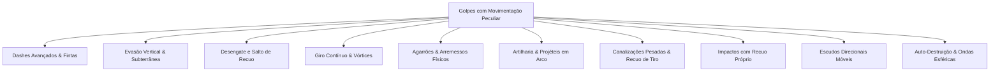

# 🗺️ Mapeamento de Peculiaridades de Movimentação e Animação no Combate Ativo

> **Projeto**: PokeMMO - Engine de Combate Ativo 2D  
> **Objetivo**: Mapear todos os ataques que exigem comportamentos especiais de física, movimentação não-linear, estados de invulnerabilidade (*i-frames*), arremessos, recuo ou canalização estática.

---

## 📌 Visão Geral dos Arquétipos com Movimentação Especial

No combate ativo (WASD, 8 direções, mira, dodge e colisões em tempo real), os ataques deixam de ser uma fórmula matemática abstrata e passam a depender diretamente de **física espacial**, **janelas de reação (telegrafia)** e **mudança de estado da entidade**.

Identificamos **11 famílias de ataques com peculiaridades marcantes**:

---

## 1. Dashes de Altíssima Velocidade (*Priority Gap-Closers*)

*Golpes que no jogo por turnos tinham prioridade +1/+2.*

* **Golpes Mapeados**: `Extreme Speed`, `Quick Attack`, `Aqua Jet`, `Mach Punch`, `Bullet Punch`, `Shadow Sneak`, `Sucker Punch`, `Fake Out`, `Feint`.
* **Comportamento de Movimentação**:
  * O atacante ganha uma aceleração instantânea massiva (950 a 1300 px/s) em linha reta em direção ao alvo.
  * O tempo de deslocamento é curtíssimo (200 a 350 ms).
  * A entidade ganha **hitbox ofensiva ativa** durante todo o percurso. Ao colidir com o oponente, interrompe o dash e aplica dano imediato.
* **Comportamento de Animação**:
  * Rastro de *afterimages* (fantasmas translúcidos) nas cores do elemento (ex: azul claro para Aqua Jet, cinza para Quick Attack, sombras arroxeadas para Shadow Sneak).
  * O sprite do Pokémon adota uma pose de corrida ou voo rasante rente ao solo.
* **Contra-jogo / Esquiva**:
  * Requer antecipação ou reação rápida de esquiva lateral (*Dodge roll*) no momento em que o atacante inicia a animação de arrancada.

---

## 2. Fintas, Curvas Divergentes e Desaparecimento (*Blink / Feint*)

*Golpes que desviam propositalmente da linha reta antes do impacto.*

* **Golpes Mapeados**: `Feint Attack`, `Shadow Force`, `Phantom Force`.
* **Comportamento de Movimentação**:
  * **Fase 1 (Divergência)**: O atacante avança em um ângulo oblíquo (75° a 115° em relação à linha do inimigo), forçando o oponente a errar a mira ou gastar a esquiva no vazio.
  * **Fase 2 (Re-alinhamento)**: No meio do percurso, o atacante faz uma curva fechada ou surge colado nas costas do alvo (*flank*).
  * Em `Shadow Force` / `Phantom Force`: O Pokémon fica com opacidade 0 (invisível e sem colisão física por 600 ms) e reaparece imediatamente atrás do alvo desferindo o ataque.
* **Comportamento de Animação**:
  * Efeito de fumaça sombria / distorção de pixel art no ponto onde o Pokémon desapareceu e no ponto onde ressurge.

---

## 3. Desengate e Salto Tático (*Hit-and-Run / Disengage*)

*Golpes de bate-e-volta para criar distância tática.*

* **Golpes Mapeados**: `U-turn`, `Volt Switch`, `Acrobatics`.
* **Comportamento de Movimentação**:
  * **Avanço**: O Pokémon avança rapidamente em direção ao alvo (velocidade 800 px/s).
  * **Impacto**: Ao atingir a hitbox do adversário, causa dano e knockback leve no inimigo.
  * **Recuo Acrobático (Back-dash)**: Imediatamente após o impacto, o atacante é arremessado para trás em arco parabólico (`jumpOffset > 0`), aterrissando a cerca de 180-240 pixels de distância segura.
* **Comportamento de Animação**:
  * Salto giratório com rotação do sprite no ar durante a fase de recuo.
* **Utilidade Tática**:
  * Permite que atacantes mistos ou de longa distância causem dano melee e imediatamente restaurem a distância ideal de combate.

---

## 4. Evasão Vertical e Subterrânea (*I-Frames / Semi-Invulnerabilidade*)

*Golpes que no jogo clássico duravam 2 turnos, tirando o Pokémon da tela.*

* **Golpes Mapeados**: `Dig`, `Fly`, `Bounce`, `Dive`, `Sky Attack`, `Sky Drop`.
* **Comportamento de Movimentação**:
  * **Subterrâneo (`Dig`)**:
    * O Pokémon cava no chão e fica invisível na superfície por 1.0 a 1.4s.
    * Estado de *I-Frames*: Fica imune a ataques terrestres e projéteis normais.
    * Uma pequena nuvem de poeira rasteira indica o deslocamento subterrâneo do Pokémon em direção ao adversário.
    * Ao expirar o tempo ou ao comando do jogador, irrompe do solo para cima, arremessando o alvo no ar (*knockup*).
  * **Aéreo (`Fly`, `Bounce`, `Sky Attack`)**:
    * O Pokémon alça voo elevando seu `jumpOffset` verticalmente além do topo do canvas.
    * A sombra do Pokémon permanece no piso da arena indicando onde ele está pairando.
    * Um retículo telegrafado no chão mostra a área de impacto 400 ms antes da queda em mergulho veloz.
* **Contra-jogo**:
  * Observar o movimento da poeira (`Dig`) ou da sombra/retículo (`Fly`) e rolar no momento exato do impacto.

---

## 5. Giros Contínuos, Esferas e Vórtices (*Spinning & Rollout*)

*Golpes baseados em rotação contínua da entidade.*

* **Golpes Mapeados**: `Rapid Spin`, `Rollout`, `Steamroller`, `Gyro Ball`.
* **Comportamento de Movimentação**:
  * `Rapid Spin`: O Pokémon gira rapidamente sobre seu próprio centro enquanto mantém movimentação livre de 8 direções. Durante o giro, ganha uma hitbox circular que deflete projéteis fracos e destrói armadilhas de terreno (*hazards*).
  * `Rollout` / `Steamroller`: O Pokémon se transforma em uma bola rolante e avança ricocheteando nas bordas da arena. A cada acerto consecutivo, a velocidade e o raio de colisão aumentam.
* **Comportamento de Animação**:
  * Rotação contínua do sprite em 360° em alta taxa de quadros, com poeira radial e faíscas nas bordas.

---

## 6. Agarrões, Imobilizações e Arremessos (*Grappling & Throwing*)

*Golpes de luta que manipulam a posição física do alvo.*

* **Golpes Mapeados**: `Seismic Toss`, `Circle Throw`, `Storm Throw`, `Submission`, `Vital Throw`, `Wrap`, `Bind`, `Clamp`.
* **Comportamento de Movimentação**:
  * O atacante realiza um dash de curto alcance. Se fizer contato, ambos entram em estado de `grapple` (o oponente fica preso à frente do atacante por 300-500 ms).
  * `Seismic Toss`: O Pokémon salta junto com o alvo no ar (`jumpOffset = 60px`), gira em parábola e esmaga o alvo no chão, deixando um decalque de cratera (`crack`) e aplicando screen shake.
  * `Circle Throw`: O atacante gira 360° e arremessa o alvo em linha reta para longe com alta velocidade, causando dano se o alvo colidir contra as paredes da arena.
  * `Wrap` / `Bind`: O atacante reduz a velocidade de ambos enquanto causa dano contínuo por segundo (DoT + Root).

---

## 7. Saltos com Risco de Falha (*High Risk Aerial Kicks*)

*Golpes que punem o atacante caso o alvo desvie no timing certo.*

* **Golpes Mapeados**: `High Jump Kick`, `Jump Kick`.
* **Comportamento de Movimentação**:
  * O Pokémon executa um salto diagonal ascendente e depois mergulha velozmente com a perna estendida em um ângulo de 45°.
  * **Se acertar**: Dano massivo e knockback contundente no alvo.
  * **Se errar / Oponente esquivar**: O atacante não para no ar, colide bruscamente contra o piso da arena, sofre animação de atordoamento (*crash stun* de 500 ms) e perde 50% do dano potencial em si mesmo.

---

## 8. Artilharia e Projéteis em Parábola (*Lobbed / Mortar*)

*Projéteis que sobem no ar e descem no alvo em vez de viajar rente ao chão.*

* **Golpes Mapeados**: `Sludge Bomb`, `Mud Bomb`, `Seed Bomb`, `Egg Bomb`, `Rock Slide`, `Stone Edge`, `Draco Meteor`.
* **Comportamento de Movimentação**:
  * O projétil é lançado para cima com uma velocidade vertical `vz` e horizontal `vx, vy`.
  * Ignora barreiras baixas ou outros Pokémons que estejam no meio do caminho durante a subida.
  * **Retículo Telegrafado**: No chão da arena surge um marcador circular na posição de destino.
  * Ao aterrissar: O projétil explode em área de efeito (AoE), espalhando estilhaços radiais e deixando poças ou rachaduras no chão.

---

## 9. Canalizações Pesadas e Recuo de Disparo (*Stationary Channeling & Recoil Pushback*)

*Ataques de poder destrutivo que limitam a mobilidade do atacante.*

* **Golpes Mapeados**: `Hyper Beam`, `Giga Impact`, `Hydro Pump`, `Solar Beam`, `Blast Burn`, `Frenzy Plant`, `Hydro Cannon`.
* **Comportamento de Movimentação**:
  * Durante o carregamento (150-300 ms), o Pokémon fica imóvel canalizando energia.
  * Durante o disparo contínuo do feixe (600-900 ms), o atacante sofre **Pushback de Recuo** (é empurrado suavemente para trás pela força da propulsão do laser/água).
  * **Janela de Recuperação (*Recharge*)**: Em `Hyper Beam` e `Giga Impact`, o atacante fica com velocidade de movimento reduzida em 60% por 1.0 segundo após o disparo, criando uma janela clássica para o oponente punir.
* **Interação de Arena**:
  * Se colidir com outro feixe disparado pelo adversário, ativa a disputa de feixes do [attackClashSystem.js](file:///e:/Projetos/PokeMMO/client/src/battle/attackClashSystem.js).

---

## 10. Auto-Recuo Físico por Colisão Brutal (*Self-Knockback Recoil*)

*Golpes em que a força do impacto ricocheteia no próprio usuário.*

* **Golpes Mapeados**: `Take Down`, `Double-Edge`, `Volt Tackle`, `Flare Blitz`, `Brave Bird`, `Head Smash`, `Wood Hammer`.
* **Comportamento de Movimentação**:
  * Dash devastador com velocidade de 900+ px/s.
  * No momento do impacto, o alvo é arremessado para longe (`pushSpeed: 600`), e o **usuário ricocheteia** para trás (`this.vx = -nx * 140, this.vy = -ny * 140`) com uma breve desaceleração de 150 ms e pequena perda de HP percentual pelo impacto.

---

## 11. Escudos e Barreiras Direcionais Móveis (*Active Shields*)

*Mecânicas de bloqueio ativo e contra-ataque reativo.*

* **Golpes Mapeados**: `Protect`, `Detect`, `King's Shield`, `Spiky Shield`, `Light Screen`, `Reflect`.
* **Comportamento de Movimentação**:
  * O Pokémon reduz a velocidade de caminhada em 50% enquanto ergue uma barreira de energia à sua frente orientada na direção do seu facing (ângulo de mira).
  * Qualquer projétil ou dash que atinja o arco frontal do escudo é anulado ou absorvido.
  * Em `Spiky Shield` / `King's Shield`: Se um inimigo colidir fisicamente com o escudo em um dash melee, o atacante sofre repulsão imediata e dano reflexivo / debuff de velocidade.

---

## 12. Armadilhas e Vórtices de Aprisionamento (*Trapping Vortex & Ground Hazards*)

*Habilidades que alteram as regras de movimentação dentro de uma zona de arena.*

* **Golpes Mapeados**: `Fire Spin`, `Whirlpool`, `Sand Tomb`, `Magma Storm`, `Sticky Web`.
* **Comportamento de Movimentação**:
  * Spawna uma zona circular na arena por 3 a 5 segundos.
  * Pokémons dentro da área têm sua aceleração de WASD limitada ou são puxados continuamente em direção ao epicentro do vórtice (efeito de atrito / força centrípeta).
  * Em `Sticky Web`: Reduz a velocidade de qualquer um que cruzar a área em 40%.

---

## 🛠️ Resumo Técnico para Implementação na Engine

| Arquétipo | Propriedade Chave em `pokemonEntity.js` | Função / Sistema Responsável |
| :--- | :--- | :--- |
| **High-Speed Dash** | `dashSpeed: 1100`, `state: 'dashing_strike'` | `fireMeleeDash()` com hitbox ativa contínua |
| **Feint / Blink** | `feintPhase: 1`, `feintAngle: targetAngle ± 1.4` | Curva angular em duas fases ou teleporte |
| **Recuo Acrobático** | `jumpOffset > 0`, `reboundVelocity: -vector * 400` | Back-dash após trigger de colisão |
| **Subterrâneo / Aéreo** | `isBurrowed: true`, `jumpOffset > 200`, `iFrames: true` | Pula renderização de colisão física com projéteis |
| **Giro / Spin** | `spriteRotation += dt * 25`, `reflectProjectiles: true` | `particleSystem.spawnSpinRing()` e colisão radial |
| **Artilharia em Arco** | `gravity: 980`, `targetReticle: {x, y}` | `projectileSystem.spawnLobbedProjectile()` |
| **Agarrão / Arremesso** | `attachedEntity = target`, `syncPositions: true` | Trava o alvo na frente do usuário durante o golpe |
| **Recuo de Tiro** | `recoilPushback: true`, `this.applyPush(-dir)` | Repulsão do atirador durante canalização de feixe |
